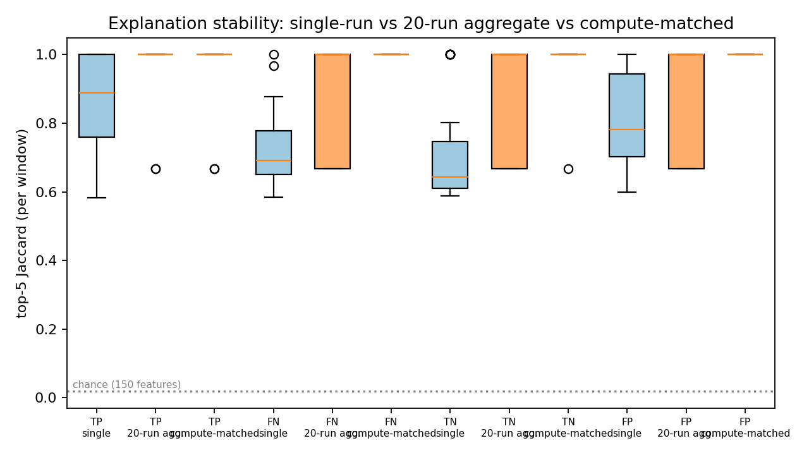
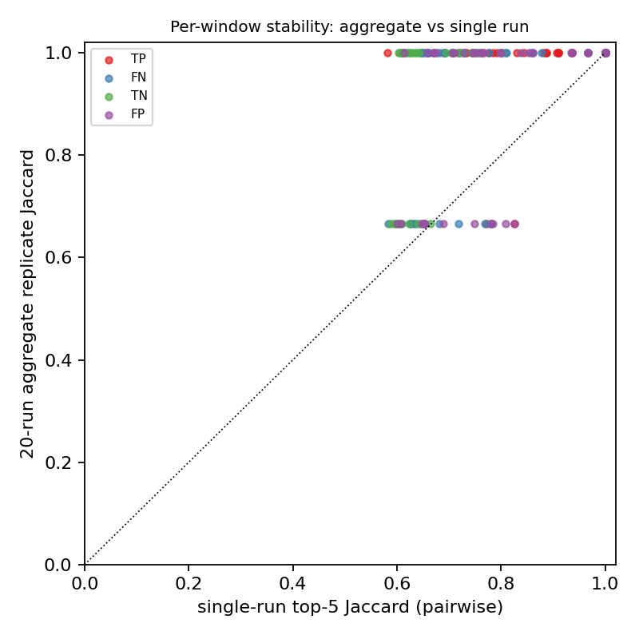
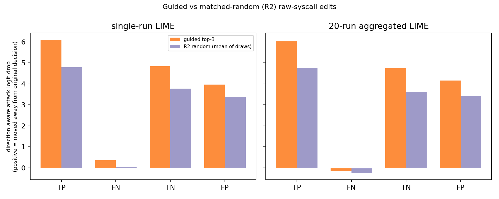
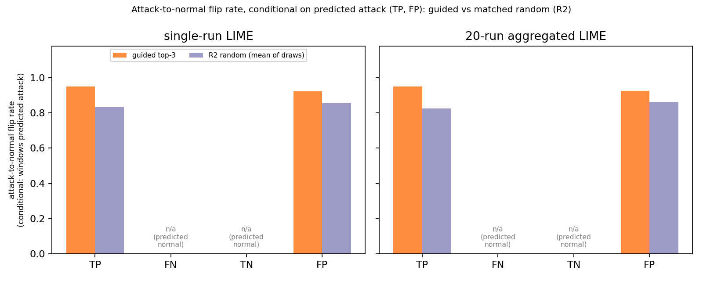
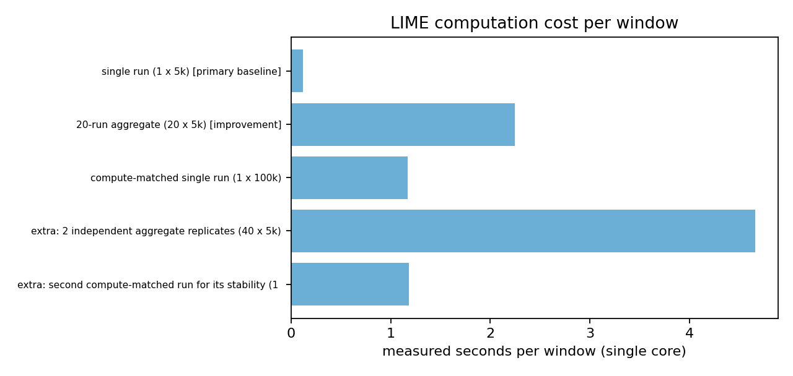

# Aggregated LIME for Intrusion-Detection Explanations

**Research extension of** *"Explainable AI for Intrusion Detection Systems: LIME and SHAP Applicability on Multi-Layer Perceptron"* (Gaspar, Silva & Silva, IEEE Access 12:30164–30175, 2024).

Course project, Explainable AI (DA351), IIIT Dharwad. Team: Thota Veda Priya, Pujari Vanaja Sudha, D. Lakshmi Soujanya, Deepika.

Phase 1 repository (frozen): https://github.com/VedaPriya-Thota/xai-ids-lime-shap-replication

> **One-sentence summary.** LIME is random, so the same alert can get different explanations on different runs; the original paper explains each instance with one run and never measures this. We test whether **averaging 20 LIME runs** makes explanations more stable and makes explanation-guided input edits more effective, and we measure what it costs. Result: **much more stable (top-5 Jaccard 0.775 → 0.923), no demonstrable gain in perturbation effectiveness (−0.051 logit units, 95% CI −0.150 to +0.054), at 19× the cost.**

> **Honesty notes up front.** (1) The authors' dataset and preprocessing were not recoverable, so Phase 1 is an *independent reconstruction*, not an exact reproduction. (2) LIME here is a *vendored stand-in*, not the official package. (3) Everything is evaluated on one frozen model. Section 12 lists every claim we do **not** make.

---

## Contents

1. [What we did and what we found](#1-what-we-did-and-what-we-found)
2. [The original paper (what it reports, with page numbers)](#2-the-original-paper-what-it-reports-with-page-numbers)
3. [Research gap](#3-research-gap)
4. [Proposed improvement](#4-proposed-improvement)
5. [What is new or modified in this repository](#5-what-is-new-or-modified-in-this-repository)
6. [Repository structure](#6-repository-structure)
7. [Setup and dependencies](#7-setup-and-dependencies)
8. [How to run and reproduce](#8-how-to-run-and-reproduce)
9. [Experimental design](#9-experimental-design)
10. [Results and comparisons](#10-results-and-comparisons)
11. [Interpretation](#11-interpretation)
12. [Limitations and claims we do not make](#12-limitations-and-claims-we-do-not-make)
13. [Reproducibility and integrity](#13-reproducibility-and-integrity)
14. [Documentation index](#14-documentation-index)
15. [Evaluator guide: where to find each required item](#15-evaluator-guide-where-to-find-each-required-item)
16. [Troubleshooting](#16-troubleshooting)
17. [References, data and AI-usage disclosure](#17-references-data-and-ai-usage-disclosure)

---

## 1. What we did and what we found

| Step | What we did | Where |
|---|---|---|
| Phase 1 | Rebuilt the paper's pipeline on public raw ADFA-LD: 30-call windows → 2-gram TF-IDF → chi-square to 150 features → MLP → LIME and SHAP explanations → perturbation check. Froze the model and hash-verified 167 files. | `src/`, `results/experiments/` |
| Gap | The paper gives one LIME explanation per instance, reports no repeated-run stability analysis, and its random-replacement test has no matched random control. | Section 3, `docs/phase2_research_gap.md` |
| Improvement | Replace one LIME run by the **mean of 20 independent runs**; compare to the single run and to one 100,000-sample run with the same query budget. | Section 4, `src/phase2/` |
| Evaluation | 160 held-out windows (40 TP, 40 FN, 40 TN, 40 FP), stability metrics, raw-syscall perturbation against matched random controls, cluster-bootstrap CIs with Holm correction, measured cost. | Sections 9–10, `results/phase2/` |

**Headline results (160 held-out windows, frozen model; 95% cluster-bootstrap CIs).**

| Question | Before: single-run LIME | After: 20-run aggregate | Verdict |
|---|---|---|---|
| Top-5 Jaccard stability | 0.775 [0.755, 0.795] | 0.923 [0.902, 0.944] (paired +0.148 [0.125, 0.172]) | **Clear improvement** |
| Ranking (\|w\| Spearman) stability | 0.806 [0.801, 0.811] | 0.977 [0.976, 0.978] (paired +0.171) | **Clear improvement** |
| Guided edits vs matched random edits (logit drop) | +0.821 [0.602, 1.037] (n=144) | +0.805 [0.609, 1.007] (n=160) | Guided edits beat random in both arms |
| Aggregate guided vs single guided | – | **−0.051 [−0.150, +0.054]**, Holm p = 0.353 | **No demonstrable improvement** |
| Cost per window | 0.118 s, 5,000 model calls | 2.245 s, 100,000 model calls | **19.1× the cost** |

---

## 2. The original paper (what it reports, with page numbers)

Page numbers are the journal page numbers printed on the page (30164–30175). Published results are **never** presented here as our own.

| Item | Paper reports | Journal page |
|---|---|---|
| Data | Generated ADFA-LD, 52,656 instances of 30 system calls (about 51% attack), 149 distinct calls | 30168, 30171 |
| Features | 2,805 TF-IDF bigrams reduced to 150 by chi-squared | 30168 |
| Model | Keras MLP, two ReLU layers and a sigmoid output (widths not reported) | 30168, 30171 |
| Metrics (Table 1) | Accuracy 0.9371, precision 0.9806, sensitivity 0.8946, specificity 0.9816, F1 0.9356 | 30171 |
| Explainers | Official `LimeTabularExplainer` and SHAP `KernelExplainer`, top-10 features per instance | 30168 |
| Perturbation, removal (Table 2, LIME) | Share of predictions changed: FN 11.12%, TP 47.20%, FP 61.21%, TN 5.98% | 30172 |
| Perturbation, random class-exclusive replacement (Table 3, LIME) | Average change: FN 63.73%, TP 69.12%, FP 82.53%, TN 35.11%; overall 62.62% | 30172 |
| Cost remark | Explanation generation can be computationally expensive; SHAP more than LIME | 30174 |
| Not stated in the text we read | LIME sample count, random seed, repeated runs, any stability measure | – |

The comparison PDF submitted with this project reproduces these pages as screenshots with their page numbers.

---

## 3. Research gap

1. **Instability is never measured.** LIME fits a surrogate on random perturbations, so two runs on the same alert can rank features differently (documented by Visani et al. 2022 and Zhou et al. 2021). The paper reports one explanation per instance.
2. **The random control is not matched.** The paper randomizes *which class-exclusive call is inserted*. It does not compare explanation-chosen edits with random edits drawn from the **same eligible pool, budget and edit rule**, so the edit rule alone could be responsible for the prediction changes.
3. **Why it matters.** An alert explanation that changes when regenerated cannot be audited by a security analyst, and a perturbation test without a matched control cannot show that the explanation (rather than the edit) did the work.

Full argument and literature: `docs/phase2_research_gap.md`.

## 4. Proposed improvement

| Aspect | Original approach (Gaspar et al.) | This work |
|---|---|---|
| Explanation | One LIME run per instance | **Mean signed coefficient of 20 independent 5,000-sample LIME runs** (100,000 model queries); full 150-vector averaged, ranked by absolute mean |
| Extra comparison | none | One 100,000-sample single run (same query budget) |
| Stability analysis | none | Top-5 Jaccard, \|w\| Spearman, sign consistency across replicates |
| Random control | Random class-exclusive replacement call | **Matched random edits** (100 draws per window) from the same eligible pool and budget (3 features) |
| Statistics | Descriptive percentages | Cluster bootstrap CIs (2,000 resamples), Holm correction, sign-flip permutation check |
| Cost | Qualitative remark | Measured runtime and model calls |

Supporting literature: Zhou, Hooker & Wang, *S-LIME: Stabilized-LIME for model explanation*, KDD 2021, pp. 2429–2438 (arXiv:2106.07875); Visani et al., *J. Oper. Res. Soc.* 73(1), 2022; Hooker et al., *NeurIPS* 2019 (random-baseline principle); Warnecke et al., *EuroS&P* 2020 (efficiency in security explanations).

---

## 5. What is new or modified in this repository

**No Phase 1 source, model, vectorizer, selector, split or result file was modified.** Phase 2 is purely additive. You can check this yourself against the frozen baseline commit:

```bash
git log --oneline                                                      # 0a1b628 = "Phase 1 frozen baseline (unmodified GitHub export)"
git diff --name-status 0a1b628 HEAD -- src lime configs scripts tests  # only "A" (added) lines for code
python -m src.phase2.run_phase2 verify                                  # 167 protected files re-hashed: "changed": []
```

### New files (Phase 2)

| File(s) | Role |
|---|---|
| `src/phase2/explain_aggregated.py` | Seeded single-run, 20-run and 100k-run LIME; `aggregate_signed()` averages the full signed 150-vector; deterministic hash-derived seeds |
| `src/phase2/metrics_stability.py` | Top-5 Jaccard, Spearman, sign consistency, surrogate R², effective sample size |
| `src/phase2/perturb_raw_sequence.py` | Raw-syscall edits: the second call of each occurrence of a selected bigram is replaced by the most frequent normal-window call |
| `src/phase2/evaluate_perturb.py` | Eligible pools, guided arm (top-3 by magnitude) and matched random arm R2 (100 draws), logit/probability/flip outcomes |
| `src/phase2/sampling.py` | Seeded 160-window selection, cap of two windows per identical-content cluster |
| `src/phase2/frozen.py` | Loads the frozen Phase 1 artifacts, checks hashes and reproduces saved predictions (tolerance 1e-10) |
| `src/phase2/analyze.py`, `run_phase2.py` | Cluster bootstrap, Holm correction, tables, 5 figures; command line (`verify`, `pilot`, `final`, `assemble`, `analyze`) |
| `scripts/phase2_audit_checks.py` | 82 independent consistency checks over the saved results |
| `scripts/phase2_supplementary_analysis.py` | Conditional flip rates and signed-vector Spearman |
| `scripts/show_headline_results.py` | Prints the headline before/after numbers from the saved CSVs (1 second) |
| `tests/` (7 new files) | `test_aggregation`, `test_stability_metrics`, `test_perturbation_controls`, `test_seed_reproducibility`, `test_sampling_cap`, `test_phase1_protection`, `test_phase2_audit` |
| `docs/phase2_*.md`, `docs/phase2_protocol.yaml`, `docs/seeds.txt` | Frozen protocol, research gap, results write-up, run instructions, post-freeze amendment record |
| `results/phase2/` | All Phase 2 results: tables, 5 figures, 1,495 individual LIME runs, per-window caches, freeze and lock files |
| `requirements-phase2.txt`, `requirements-phase2-py311.txt` | Exact environment (Python 3.12.3) and the Python 3.11 variant |

### Changed files (documentation only, all recorded in `docs/phase2_postfreeze_amendments.md`)

| File | Change |
|---|---|
| `AI_USAGE.md` | Append-only AI-usage paragraph; original bytes still hash to the baseline value |
| `README.md` | Replaced by this document. The original Phase 1 README is preserved **byte-for-byte** as `docs/PHASE1_README.md` and stays hash-protected under that name |

---

## 6. Repository structure

```text
.
├── README.md                     <- this file
├── AI_USAGE.md                   <- AI-assistance disclosure (append-only)
├── ASSUMPTIONS.md                <- every assumption made in Phase 1 (A1-A25)
├── requirements.txt              <- Phase 1 pins (older; see Section 7)
├── requirements-phase2.txt       <- environment used for Phase 2 results (Python 3.12.3)
├── requirements-phase2-py311.txt <- same pins, SHAP relaxed for Python 3.11
├── configs/                      <- baseline.yaml (frozen), reconciliation.yaml
├── data/                         <- provenance notes + frozen trace manifest (raw data NOT included)
├── lime/                         <- vendored LIME-compatible stand-in (NOT official LIME; hash-guarded)
├── src/
│   ├── (Phase 1 modules)         <- unchanged, frozen
│   └── phase2/                   <- NEW: the extension
├── scripts/                      <- Phase 1 runners + NEW Phase 2 audit/analysis scripts
├── tests/                        <- 109 passed, 1 skipped (110 with raw data)
├── docs/                         <- protocol, research gap, results, comparison with the paper
├── reports/                      <- Phase 1 summary and dataset audit
└── results/
    ├── experiments/              <- frozen Phase 1: 3A MLP, 3B LIME+SHAP, 3C perturbation
    └── phase2/                   <- NEW: all Phase 2 outputs (CSVs, figures/, lime_runs/, window_results/)
```

---

## 7. Setup and dependencies

* **Python 3.12 recommended** (the Phase 2 results were produced on 3.12.3). CPU only; no GPU needed. About 100 MB for the repository, plus the virtual environment.
* **Do not install the official `lime` package.** The vendored stand-in in `lime/` is used and hash-checked; installing the official one defeats the provenance check.
* The Phase 1 `requirements.txt` pins are older than the versions of the frozen artifacts (scikit-learn 1.8.0) and can fail to unpickle them. **Use `requirements-phase2.txt`.**

Linux / macOS:

```bash
python3.12 -m venv .venv && source .venv/bin/activate
pip install -r requirements-phase2.txt
```

Windows (PowerShell):

```powershell
py -3.12 -m venv .venv
.venv\Scripts\Activate.ps1          # if blocked: Set-ExecutionPolicy -Scope CurrentUser RemoteSigned
pip install -r requirements-phase2.txt
```

**Python 3.11:** `shap==0.54.1` needs Python 3.12 or newer, so install `requirements-phase2-py311.txt` instead (identical pins except `shap==0.51.0`). SHAP is not used by Phase 2, so this does not affect Phase 2 results.

| Package | Version |
|---|---|
| numpy / pandas / scipy | 2.4.4 / 3.0.2 / 1.17.1 |
| scikit-learn / joblib | 1.8.0 / 1.5.3 |
| matplotlib / PyYAML / tabulate | 3.10.8 / 6.0.3 / 0.10.0 |
| pytest | 9.1.1 |
| shap (Phase 1 only) | 0.54.1 (0.51.0 on Python 3.11) |

---

## 8. How to run and reproduce

### A. Five-minute verification (no dataset needed)

Run from the repository root with the environment active.

| # | Command | Expected result | Time |
|---|---|---|---|
| 1 | `python -m pytest -q` | `109 passed, 1 skipped` (the skipped test needs the raw dataset) | 15 s to 2 min |
| 2 | `python -m src.phase2.run_phase2 verify` | `"n_files_verified": 167`, `"changed": []`, `"missing": []`, LIME version `vendored-compat-0.2.0.1` | 5 s |
| 3 | `python scripts/show_headline_results.py` | Three blocks: stability, perturbation, cost (the numbers in Section 1) | 1 s |
| 4 | `python scripts/phase2_audit_checks.py` | `SUMMARY: {'PASS': 82, 'SKIP': 1}` (the skip is the raw-data cluster check) | 3 s |

### B. Regenerate tables and figures from the saved per-window results

```bash
python -m src.phase2.run_phase2 analyze --root results/phase2     # 40 s to 2 min; writes the CSV summaries and 5 figures
python scripts/phase2_supplementary_analysis.py                    # conditional flip rates + signed Spearman; about 40 s
```

Regeneration is deterministic: the regenerated tables matched the saved ones to within 2×10⁻¹³ (we checked on a second machine). Binary figure files may differ at byte level; on Windows CSV line endings may become CRLF. To discard such changes: `git checkout -- results/phase2`.

### C. Full rerun from raw data (optional; needs the raw dataset)

1. Download the public Kaggle mirror `yianqaq/adfa-ld` (`archive.zip`): <https://www.kaggle.com/datasets/yianqaq/adfa-ld>. `sha256` of the archive must be `686825e85e2cd513e5b6462adcc55c3c6d81e8bf2bac24dd912a91fa014a6454`.
2. Extract **only** the `ADFA-LD/` folder to `data/raw/ADFA-LD/`, so that `Training_Data_Master/`, `Validation_Data_Master/` and `Attack_Data_Master/` (5,951 `.txt` traces) exist. Raw data is git-ignored and must never be committed.
3. Run:
   ```bash
   python -m pytest -q                              # now 110 tests (adds the frozen-load test)
   python -m src.phase2.run_phase2 pilot            # validation split, 10 windows per group; safe to repeat
   ```
4. **Do not run `final`.** It is the single held-out test run; `results/phase2/FINAL_RUN_LOCK.json` makes it refuse a second start, and it refuses to resume unless the protocol and selected-window hashes equal `results/phase2/freeze_manifest.json`. Cost if it were rerun in a scratch copy: about 9 s of LIME per window plus a one-off eligibility scan of tens of minutes.

> **Not done by us:** an end-to-end rerun of `final` from raw traces after packaging (the raw data were not available at that time). The saved outputs are the one held-out run; sections 8A–B prove they are internally consistent and reproducible from the saved per-window files, not that the experiment re-executes from raw traces.

### D. Phase 1 pipeline (optional; needs the raw dataset)

Reruns write to **new** directories and refuse to overwrite:

```bash
python scripts/run_reconciliation.py --config configs/baseline.yaml --raw-data-dir /path/to/ADFA-LD --no-fit
PYTHONPATH=. python scripts/run_phase3a.py --config configs/baseline.yaml --raw-data-dir /path/to/ADFA-LD --experiment-dir results/experiments/phase3a_rerun
PYTHONPATH=. python scripts/run_phase3b.py --raw-data-dir /path/to/ADFA-LD --nsamples 512 --lime-num-samples 5000 --phase3a-dir results/experiments/phase3a_rerun --experiment-dir results/experiments/phase3b_rerun
PYTHONPATH=. python scripts/run_phase3c.py --raw-data-dir /path/to/ADFA-LD --phase3a-dir results/experiments/phase3a_rerun --phase3b-dir results/experiments/phase3b_rerun --experiment-dir results/experiments/phase3c_rerun
```

(On Windows PowerShell set `$env:PYTHONPATH="."` first.)

---

## 9. Experimental design

Both approaches are evaluated on the **same frozen model, the same 160 windows and the same edit rule**, so differences come from the explanation, not the setup.

* **Pipeline (frozen).** Raw ADFA-LD traces (5,951: 5,205 normal, 746 attack) → 88,828 non-overlapping 30-call windows (about 11.5% attack) → trace-disjoint stratified 70/15/15 split, seed 42 → 2-gram TF-IDF (train-only) → chi-square to 150 features → scikit-learn MLP 150-64-32-1. Held-out test set: 13,736 windows.
* **Sample.** 160 test windows: 40 TP, 40 FN, 40 TN, 40 FP; 152 distinct identical-content clusters (global cap of two windows per cluster). Eligibility: effective sample size ≥ 100, at least three present features. The protocol and the selected windows were hashed **before any perturbation outcome was computed**.
* **Conditions.** *Single run* (1 × 5,000 samples; the original approach, the "before"). *20-run aggregate* (20 × 5,000; the improvement, the "after"). *Single 100,000-sample run* (same number of model queries as the aggregate; a reference alternative).
* **Stability metrics.** Top-5 Jaccard (overlap of the five largest-|coefficient| features), \|w\| Spearman (rank correlation over all 150 features), sign consistency. "Single" stability is the mean over the 190 pairs of 20 repeated runs; aggregate and 100k stability compare two independent replicates. These are different estimands (variation of an individual explanation versus of a procedure's output).
* **Perturbation.** Edits act on the raw 30-call window, then pass through the frozen vectorizer, selector and MLP (no retraining). Budget: 3 features. *Guided* arm: top-3 by |coefficient| inside the eligible pool (present, actionable, sign-supporting). *Matched random (R2)* arm: 3 features drawn from the same pool, 100 draws per window. Outcome: direction-aware logit drop (positive = the edit moved the model away from its original decision).
* **Statistics.** 95% percentile intervals from a 2,000-replicate cluster bootstrap (unit: identical-content cluster; equal-weight mean over the four groups); Holm correction over the three primary comparisons; cluster-level sign-flip permutation test (20,000 flips) as an independent check.

---

## 10. Results and comparisons

### 10.1 Original paper versus our reconstruction (Phase 1)

| Item | Gaspar et al. (published) | Ours | Exact reproduction? |
|---|---|---|---|
| Data | Generated ADFA-LD, 52,656 instances (about 51% attack) | Raw ADFA-LD mirror, 88,828 windows (about 11.5% attack); 13,736 test windows | **No**: reconstruction |
| Vocabulary / features | 149 calls; 2,805 bigrams → 150 | 175 observed IDs; 3,379 bigrams → 150 (train-fit) | Method-level match |
| Model | Keras MLP (widths not reported) | scikit-learn MLP 150-64-32-1 | Family only |
| Split | Not described | Trace-disjoint 70/15/15, seed 42 | No |
| LIME | Official package, top-10 | Vendored stand-in, 5,000 samples | **No** |
| SHAP | `KernelExplainer`, top-10 | `KernelExplainer` 0.50.0, 100-row background, `nsamples=512` (Phase 1 only) | Same method, our settings |

| Metric | **Published** (p. 30171) | **Ours** (test split) |
|---|---:|---:|
| Accuracy | 0.9371 | 0.9374 |
| Precision (attack) | 0.9806 | 0.7345 |
| Sensitivity / recall (attack) | 0.8946 | 0.7363 |
| Specificity (recall of normal) | 0.9816 | 0.9643 |
| F1 (attack) | 0.9356 | 0.7354 |
| ROC-AUC | not reported | 0.9600 |

> **The accuracy match is not a reproduction.** Our test set is about 12% attack (an always-"normal" classifier scores 88.2%); theirs is about 51%. Precision, sensitivity and F1 are therefore not comparable. Details: `docs/phase1_result_comparison.md`.

### 10.2 Before (single-run LIME) versus after (20-run aggregate): stability

| Metric | Before: single run (5k) | After: 20-run aggregate | Paired difference | One 100k run (reference) |
|---|---|---|---|---|
| Top-5 Jaccard | 0.775 [0.755, 0.795] | 0.923 [0.902, 0.944] | **+0.148 [+0.125, +0.172]** | 0.994 [0.986, 1.000] |
| \|w\| Spearman | 0.806 [0.801, 0.811] | 0.977 [0.976, 0.978] | **+0.171 [+0.166, +0.176]** | 0.961 [0.959, 0.963] |

By group, top-5 Jaccard (before → after): TP 0.858 → 0.983, FN 0.720 → 0.900, TN 0.714 → 0.900, FP 0.808 → 0.908. Sign consistency is exactly 1.000 in every window and condition (saturated, uninformative). Chance level for top-5 Jaccard over 150 features is 0.019.





### 10.3 Before versus after: explanation-guided perturbation

Direction-aware logit drop (mean over the four groups; positive = the edit moved the model away from its original decision):

| Condition | n windows | Guided edits | Matched random (R2) |
|---|---:|---|---|
| Before: single run (5k) | 144 | 3.82 [3.37, 4.30] | 3.00 [2.66, 3.36] |
| After: 20-run aggregate | 160 | 3.69 [3.28, 4.11] | 2.89 [2.58, 3.22] |
| One 100k run (reference) | 140 | 3.61 [3.22, 4.06] | 3.09 [2.74, 3.44] |

Primary paired comparisons (Holm-corrected over these three):

| Comparison | n | Estimate [95% CI] | Holm p |
|---|---:|---|---:|
| Single guided − single random | 144 | +0.821 [+0.602, +1.037] | .003 |
| Aggregate guided − aggregate random | 160 | +0.805 [+0.609, +1.007] | .003 |
| **Aggregate guided − single guided** (the improvement) | 159 | **−0.051 [−0.150, +0.054]** | **.353** |

Windows whose R2 pool has fewer than four eligible features are excluded from that arm's guided-versus-random comparison (single run 16 of 160, query-matched 20, aggregate 0), hence the different n. A cluster-level sign-flip test gave p < 5×10⁻⁵ for both guided-minus-random comparisons and p ≈ .33 for aggregate versus single.



**Prediction flips among windows predicted as attack (TP and FP; flip = label changes to normal).**

| Condition | n | Guided flip rate | Matched random flip rate | Guided − random |
|---|---:|---|---|---|
| Before: single run | 77 | 0.935 [0.861, 0.987] | 0.844 [0.776, 0.902] | +0.091 [+0.049, +0.133] |
| After: aggregate | 80 | 0.938 [0.866, 0.988] | 0.843 [0.775, 0.898] | +0.094 [+0.054, +0.134] |

Random edits alone flip about 84% of attack-predicted windows, so flips are weak evidence unless read against the matched control.



### 10.4 Cost

| Condition | Seconds per window | Model calls | Relative cost |
|---|---:|---:|---:|
| Before: single run (1 × 5k) | 0.118 | 5,000 | 1.0× |
| After: 20-run aggregate (20 × 5k) | 2.245 | 100,000 | **19.1×** |
| One 100k run (same query budget) | 1.169 | 100,000 | 9.9× |

Single core, indicative only; memory was not measured.



> **The 100k run is not a like-for-like alternative.** It is more top-5 stable (0.994 vs 0.923) at about half the runtime, but under our stand-in (ridge fitted on raw-unit perturbations, unlike official LIME which standardizes first) its coefficients are systematically larger (mean norm 2.69 vs 1.29 for the aggregate) and its top-5 agrees with the aggregate's only 0.42 on average. It estimates a *different coefficient vector*, so "one large run beats averaging" cannot be concluded until this is repeated against official LIME.

### 10.5 Did the improvement address the research gap?

| Element of the gap | Result | Addressed? |
|---|---|---|
| LIME instability is never measured | Measured: single-run top-5 Jaccard is only 0.775 | Yes, quantified |
| Single-run explanations are unstable | Averaging 20 runs gives 0.923 / 0.977 | **Yes**, at 19× the cost |
| Guided edits not contrasted with matched random edits | Guided beats matched random by about 0.8 logit units; random edits alone flip about 84% | **Yes** (control added) |
| Stabler explanations should select better edits | Aggregate vs single guided −0.051 [−0.150, +0.054]; the guided top-3 set is identical in 132 of 159 windows | **Not demonstrated** (honest negative result) |

### 10.6 Paper's perturbation results versus ours: why they are not directly comparable

| | Published (Tables 2–3, p. 30172) | Ours (Phase 2) |
|---|---|---|
| Instances | All 52,656 | 160 held-out windows |
| Edit | Remove or replace the 10 most important calls | Replace the second call of 3 selected bigrams, then re-score |
| Control | Random class-exclusive call (which call is inserted) | Matched random features from the **same eligible pool and budget** |
| Metric | Share of predictions changed (5.98% to 82.53%) | Direction-aware logit drop, flip rate among attack-predicted windows |
| Headline | Random replacement changes about 62.62% of predictions | Guided edits flip 93.8%, matched random edits flip 84.3% (attack-predicted windows) |

Both agree qualitatively that input edits can change the model's decision; they differ in protocol, so the percentages must not be compared numerically. A Phase 1 descriptive run on 20 frozen instances is in `results/experiments/phase3c_perturbation_evaluation/` (guided vs random label flips for LIME stand-in 9/20 vs 6/20; for Kernel SHAP 9/20 vs 8/20; no significance test).

---

## 11. Interpretation

* Averaging reliably reduces the run-to-run variation of ordinary 5,000-sample LIME. Because averaging independent estimates reduces variance by construction (replicate-to-replicate RMS coefficient difference is 0.0068 for two 20-run aggregates, as 1/√20 predicts), the empirical content is the size of the gain (large), its cost (19×), and whether it matters downstream (not demonstrably, here).
* Explanation-guided edits carry real model-specific information: they beat matched random edits by about 0.8 logit units (TP +1.26, TN +1.14, FP +0.74, FN +0.09 for the aggregate). Aggregation adds nothing detectable on top, plausibly because the guided top-3 set is the same under both explanations in 83% of windows (a plausible reason, not proof).
* Flip counts alone are misleading: perturbation studies should report a matched random control.
* The surrogate fits the MLP only moderately (weighted R² 0.385 single run, 0.442 at 100k), so the local linear explanation should not be over-interpreted.

## 12. Limitations and claims we do not make

**We do not claim:** exact reproduction of any paper result; that we recovered the authors' dataset; that aggregated explanations are more *faithful* or causally informative (we measured repeatability); that one large run beats averaging; that results generalize beyond this one frozen model, dataset pipeline and seed family; that our perturbations resemble realistic attacker behavior; that the LIME results come from the official package; that LIME is better than SHAP or the reverse.

**Limitations.**
1. Vendored LIME stand-in, not validated against official LIME (the most important unresolved threat).
2. Reconstructed data, class balance (12% vs 51% attack), vocabulary and split; one frozen MLP; SHAP not part of Phase 2.
3. Stability is repeatability, not faithfulness.
4. Perturbation edits follow one deterministic rule, can cascade (about 79–80% of guided edits apply all three features), and guided and random arms match on requested features, not on positions edited (a post hoc adjustment leaves the guided advantage at +0.72 to +0.80).
5. 152 clusters for 160 windows; TP and FP have 38 clusters for 40 windows; residual train/test content overlap cannot be excluded.
6. TP/TN windows were screened lazily in seeded order, so the sample is not a uniform draw; primary comparisons use different window sets (144/160/159).
7. Runtimes are indicative; no end-to-end rerun from raw traces after packaging.
8. The user survey of the original paper was not replicated.

---

## 13. Reproducibility and integrity

* **Seeds.** Base seed 42. Phase 2 seeds are `sha256("42|stream|window|run")[:8]`; bootstrap seed 20261023 (`docs/seeds.txt`).
* **Frozen baseline.** 167 Phase 1 files are hash-verified by `verify`. The trace manifest SHA-256 is `765289887ac57f0a7f08b0d2761c9507e65f8ff98805ab69dc08a6cc312bf4f1`.
* **Frozen protocol.** `docs/phase2_protocol.yaml` and `results/phase2/selected_windows.csv` are hashed in `results/phase2/freeze_manifest.json` (written before any perturbation outcome existed). The held-out run is locked by `FINAL_RUN_LOCK.json`.
* **Post-freeze changes** are listed in `docs/phase2_postfreeze_amendments.md`: two source files (verification logic and table bookkeeping/figure labels, none read while experiments run), plus documentation. Git history alone cannot date result generation; the amendment record explains the supporting evidence.
* **Tests and audit.** 109 tests pass (1 skipped); 82 audit checks pass (1 skipped). Both were run in two environments: Linux with Python 3.12.3 and Windows with Python 3.11.9, with identical outcomes.
* **Individual LIME runs** (full signed 150-vectors, seeds, runtimes, R²) are kept in `results/phase2/lime_runs/*.npz` so every aggregate can be re-derived.
* **Line endings (Windows).** `verify` hashes raw bytes. The repository ships a `.gitattributes` (`* -text`) so Git never rewrites line endings; if `verify` reports changed files after a Windows clone, line-ending conversion is the cause.

---

## 14. Documentation index

| Document | Purpose |
|---|---|
| `docs/phase2_research_gap.md` | The gap, why it matters, literature |
| `docs/phase2_results.md` | Full Phase 2 results write-up |
| `docs/phase2_protocol.yaml`, `docs/seeds.txt` | Locked protocol and seed derivation |
| `docs/phase2_README.md` | Detailed Phase 2 run instructions |
| `docs/phase2_postfreeze_amendments.md` | Audit record of every post-freeze change |
| `docs/PHASE1_README.md` | The original Phase 1 README, preserved byte-for-byte |
| `docs/phase1_result_comparison.md` | Detailed paper-versus-ours comparison (Phase 1) |
| `docs/phase3b_xai_explanations.md`, `docs/phase3c_perturbation_extension.md` | Phase 1 LIME/SHAP and perturbation detail |
| `docs/paper_extraction.md`, `docs/paper_dataset_forensics.md` | What the paper states; the search for the authors' dataset |
| `docs/lime_official_package_verification.md` | Plan to check the stand-in against official LIME |
| `docs/frozen_artifact_notes.md`, `ASSUMPTIONS.md`, `docs/replication_protocol.md` | Legacy labels, assumptions, fixed decisions |
| `reports/` | One-page Phase 1 summary, dataset audit |

## 15. Evaluator guide: where to find each required item

| Requirement | Where |
|---|---|
| Research gap, why it matters, literature | Section 3; `docs/phase2_research_gap.md` |
| Proposed improvement, supporting article, difference from the original | Section 4 (S-LIME, Visani, Hooker, Warnecke) |
| Implementation: modified and new files clearly identified | Section 5; `git diff --name-status 0a1b628 HEAD` |
| Experiments with original approach and improved approach under comparable conditions | Sections 9–10 (same frozen model, same 160 windows, same edit rule) |
| Quantitative before/after results, tables and graphs | Section 10 and `results/phase2/figures/` |
| Original paper's results kept separate from ours | Sections 2, 10.1, 10.6 (published numbers carry journal page numbers) |
| Interpretation and limitations | Sections 11–12 |
| Execution procedure, dependencies, reproduction steps | Sections 7–8 |
| Integrity of the comparison (frozen model, hashed protocol, audit) | Section 13 |
| AI-assistance disclosure | `AI_USAGE.md` |

## 16. Troubleshooting

| Symptom | Cause and fix |
|---|---|
| `pip` cannot find `shap==0.54.1` | Python 3.11 or older. Use Python 3.12, or `requirements-phase2-py311.txt` |
| `verify` reports changed files after cloning on Windows | Git converted line endings. Use the shipped `.gitattributes`, or `git config core.autocrlf false` and re-clone |
| `git status` shows modified `results/phase2/*` after `analyze` | CRLF line endings or re-rendered PNGs; numbers are unchanged. Restore with `git checkout -- results/phase2` |
| Unpickling errors for the frozen model | Wrong scikit-learn version; the artifacts need 1.8.0 |
| `run_phase2 final` refuses to start | By design (`FINAL_RUN_LOCK.json`); the held-out run was done once |
| One test skipped, one audit check SKIP | They need the raw ADFA-LD dataset (Section 8C) |
| PowerShell blocks `Activate.ps1` | `Set-ExecutionPolicy -Scope CurrentUser RemoteSigned` |

## 17. References, data and AI-usage disclosure

1. D. Gaspar, P. Silva and C. Silva, "Explainable AI for intrusion detection systems: LIME and SHAP applicability on multi-layer perceptron," *IEEE Access*, vol. 12, pp. 30164–30175, 2024, doi:10.1109/ACCESS.2024.3368377.
2. Z. Zhou, G. Hooker and F. Wang, "S-LIME: Stabilized-LIME for model explanation," *Proc. 27th ACM SIGKDD Conf. Knowledge Discovery and Data Mining*, 2021, pp. 2429–2438, arXiv:2106.07875.
3. G. Visani, E. Bagli, F. Chesani, A. Poluzzi and D. Capuzzo, "Statistical stability indices for LIME: Obtaining reliable explanations for machine learning models," *J. Oper. Res. Soc.*, vol. 73, no. 1, pp. 91–101, 2022, doi:10.1080/01605682.2020.1865846.
4. S. Hooker, D. Erhan, P.-J. Kindermans and B. Kim, "A benchmark for interpretability methods in deep neural networks," *NeurIPS 32*, 2019, pp. 9737–9748.
5. A. Warnecke, D. Arp, C. Wressnegger and K. Rieck, "Evaluating explanation methods for deep learning in security," *IEEE EuroS&P*, 2020, arXiv:1906.02108.
6. M. T. Ribeiro, S. Singh and C. Guestrin, "Why should I trust you?: Explaining the predictions of any classifier," *KDD*, 2016, pp. 1135–1144.
7. S. M. Lundberg and S.-I. Lee, "A unified approach to interpreting model predictions," *NeurIPS 30*, 2017.
8. G. Creech and J. Hu, "A semantic approach to host-based intrusion detection systems using contiguous and discontiguous system call patterns," *IEEE Trans. Comput.*, vol. 63, pp. 807–819, 2014 (ADFA-LD).

**Data.** Public raw ADFA-LD Kaggle mirror, <https://www.kaggle.com/datasets/yianqaq/adfa-ld>; it is not the paper authors' generated dataset and is not redistributed here (`data/README.md`).

**AI-usage disclosure.** AI assistance was used for drafting, coding support and auditing. Tools, purpose and how outputs were checked are recorded in [`AI_USAGE.md`](AI_USAGE.md).
